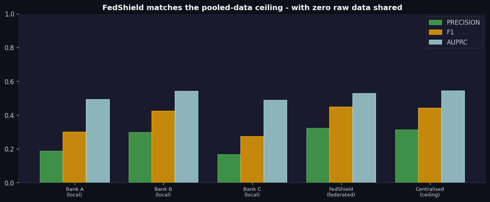
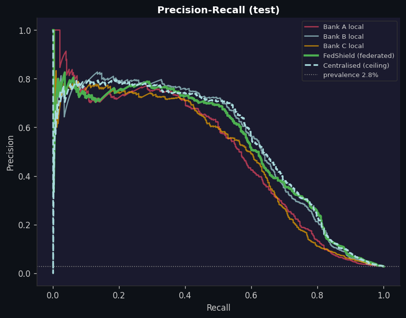
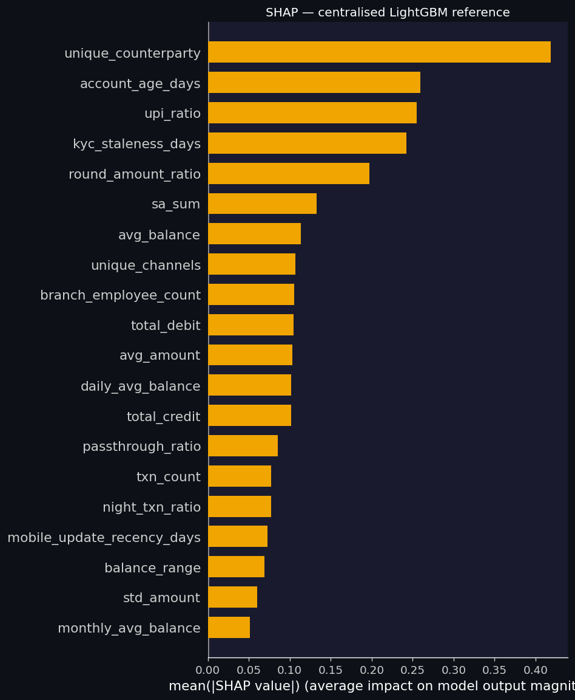

<div align="center">

# 🛡️ FedShield

### Privacy-Preserving Federated Mule-Account Detection for UPI

*Banks learn to catch money mules together — without a single customer record ever leaving the bank.*


**St Aloysius FinTech Innovation Hackathon 2026 · Track 1 — Digital Payments Fraud Detection & Prevention**

Dharani K · Thanushrie Satishkumar — Sri Sairam Engineering College, Chennai

</div>

---

## The problem

UPI fraud detection is **siloed**. Each bank trains on its own transactions alone, so a mule account that Bank A has already identified keeps operating undetected at Bank B and Bank C. There is no mechanism for banks to share fraud intelligence across institutional boundaries — and sharing raw transaction data is prohibited under RBI data-localisation and the DPDP Act, 2023. The result is a fragmented defence: fraudsters exploit the gaps between banks while every institution reinvents the same detection logic.

## The idea

**FedShield** lets banks build a shared mule-detection capability **without exchanging any raw data**. Each bank trains its own model locally; only the trained models are combined by a neutral aggregator (a role RBI or NPCI could hold). A bank then scores every incoming account on its own systems — no outside call at decision time.

## What we actually proved

Evaluated on the RBIH–IIT Delhi **NFPC Phase-2** dataset (96,091 labelled accounts, 2.8% mule prevalence, 19,219-account held-out test) using **point-in-time features** — every feature is built only from transactions *before* the scoring date, so the model never peeks at the future.

| Model | AUPRC | Precision | Recall | F1 | Flag % |
|---|:---:|:---:|:---:|:---:|:---:|
| Best single bank (Bank B, local only) | 0.542 | 0.298 | 0.734 | 0.424 | 6.9% |
| **FedShield — federated, 0 raw data shared** | **0.527** | **0.321** | **0.739** | **0.448** | **6.4%** |
| Centralised (all data pooled — privacy-free ceiling) | 0.542 | 0.312 | 0.745 | 0.440 | 6.7% |

**Two headline results:**

1. **Privacy is almost free.** FedShield reaches AUPRC **0.527** against a privacy-free pooled-data ceiling of **0.542** — within a rounding error of what you would get by pooling every bank's raw data in one place, while sharing **none** of it.
2. **Fewest false holds.** At the live decision threshold, FedShield gives the **most precise alerts (0.321) at the lowest flag rate (6.4%)** of any model tested — beating even the centralised model. That means fewer genuine customers wrongly held, which is exactly RBI's stated concern in the draft debit-hold SOP.

> 

## How it works

```
Bank A ─┐                         each bank keeps its data
Bank B ─┼─► train local model ──► SHARE MODEL ONLY ──► neutral aggregator
Bank C ─┘   (no rows leave)        (secure aggregation)        │
                                                               ▼
        every bank scores incoming accounts locally ◄── combined model
                 (no outside call at decision time)
```

- **Point-in-time features** — streaming transaction aggregation with a hard cut-off date; no post-cut-off behaviour enters any feature, so early-detection numbers are honest.
- **Non-IID bank simulation** — the dataset is split into banks that hold *genuinely different* fraud exposure (by mule-pattern `alert_reason`, falling back to `branch_state` region), so the experiment tests real cross-bank transfer, not just "more data."
- **The deployed detector** — per-bank **LightGBM**; only trained models are shared, combined by size-weighted probability averaging. Privacy comes from (i) no raw data leaving a bank and (ii) secure aggregation.
- **Auditable linear baseline + measured privacy cost** — a transparent NumPy **FedAvg** path with a **differential-privacy** knob, plus a measured privacy/utility curve and a reported ε, so the privacy claim is quantified rather than asserted.
- **Explainable alerts** — SHAP reason codes for every hold, to populate the plain-language customer notice the RBI draft SOP requires.

## Results & figures

| | |
|---|---|
|  |  |
| **Precision–Recall** — FedShield sits on the centralised ceiling, above individual banks at high recall. | **SHAP reason codes** — top drivers (unique counterparties, account age, UPI ratio, round-amount ratio) for the customer notice. |

All numbers and figures are regenerated from scratch by the notebook; CSVs are written to the output directory.

## Reproduce it

The entire pipeline runs on the **Kaggle free tier (CPU)** — no GPU needed.

1. Open the notebook on Kaggle.
2. **Add Input** → search `rbih-nfpc-phase-2` (publisher `abhyudayrbih`) → attach.
3. **Accelerator: None (CPU).** A GPU gives no speedup here (pandas / NumPy / LightGBM are CPU-bound) and leaves less RAM, which is the real constraint.
4. **Run All.** First run ≈ 20–30 min (transaction streaming dominates); heavy steps checkpoint, so re-runs skip straight to modelling.

> Point-in-time cut-off, number of banks, privacy level and operating recall are all set in the config block at the top of the notebook.

## Repository

```
fedshield/
├── FedShield.ipynb        # full, runnable, step-by-step notebook (start here)
├── figures/               # generated charts (PNG)
├── results/               # generated metrics (CSV)
├── README.md
└── LICENSE
```

## Honest scope & future work

We report what the data supports, not what sounds best.

- On this dataset, mule **behaviour is learnable from a single bank's own data**, so FedShield's value here is **privacy-preserving parity plus more precise, more stable alerts** — not a raw-accuracy jump over a strong single bank.
- The larger cross-bank prize is **network-level signal** (mule rings that span institutions), which model-sharing alone cannot carry. A privacy-preserving graph-intelligence layer is the natural next step.
- The banks are one dataset partitioned, not real institutions; labels are the dataset's own mule flags (mostly from a 2025 sweep), so absolute early-detection numbers are bounded by that — as they are for every solution on this data.
- The broader multi-source evidence-fusion design (EFRM / AML / I4C / DPIP) is the intended production architecture; **this repository validates the learning core on public data only.**

**Path to a pilot:** two real banks + a neutral aggregator (RBI / NPCI), per-bank local preprocessing, an agreed privacy configuration (secure aggregation, optional DP at a chosen budget), and a recall/precision operating point signed off by fraud-ops before go-live.

## Dataset

RBIH & IIT Delhi — **National Fraud Prevention Challenge (NFPC) Phase-2**, Kaggle: `abhyudayrbih/rbih-nfpc-phase-2` (CC BY-NC-SA 4.0). ~400M transactions, ~96k labelled accounts over 2020–2025. Synthetic data based on real-world mule patterns; **no confidential or real customer data is used**.

## Team

**Dharani K** · **Thanushrie Satishkumar** — Sri Sairam Engineering College, Chennai
St Aloysius FinTech Innovation Hackathon 2026 · Track 1.

## License

Released under the **MIT License**. Dataset usage follows its own CC BY-NC-SA 4.0 terms.

---

<div align="center"><sub>Built for the RBIH NFPC / St Aloysius FinTech Innovation Hackathon 2026 · privacy-first fraud intelligence for India's payment rails.</sub></div>
